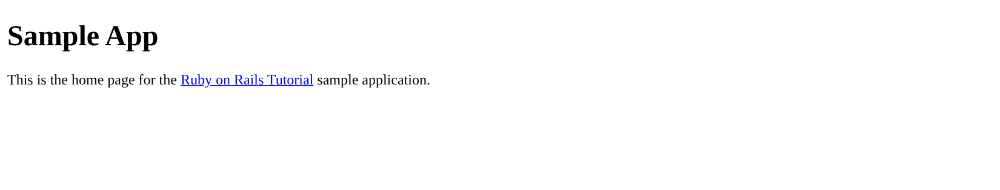
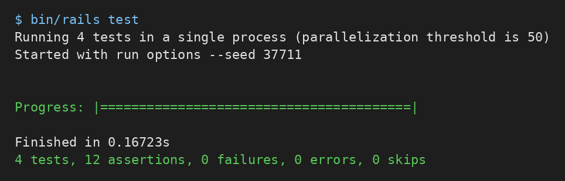
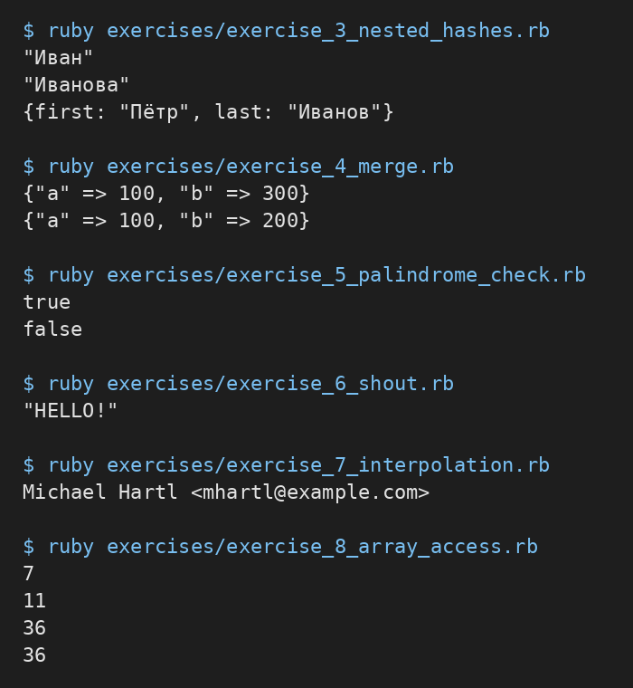
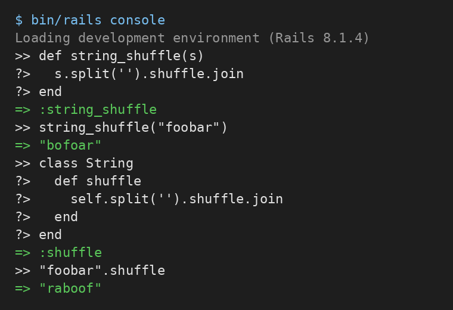
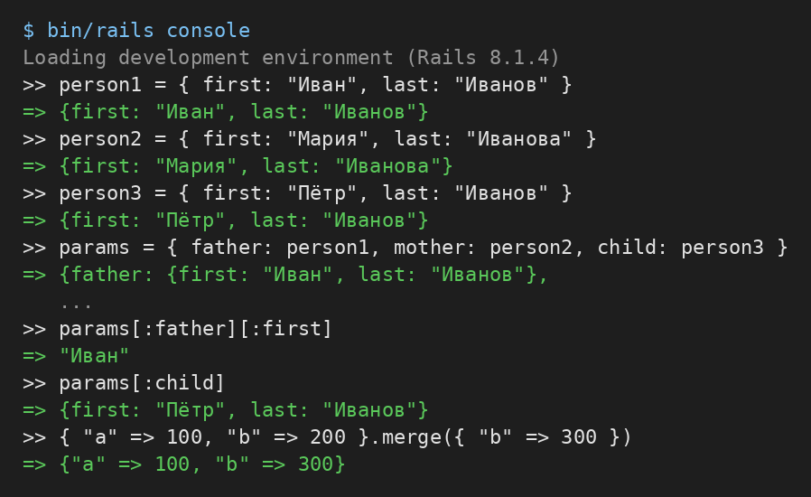
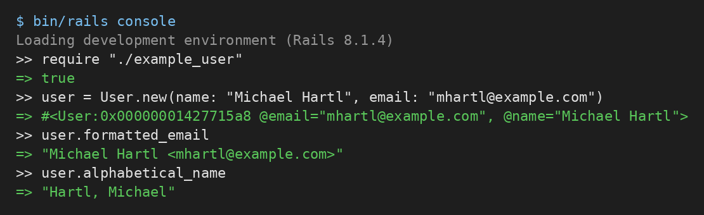
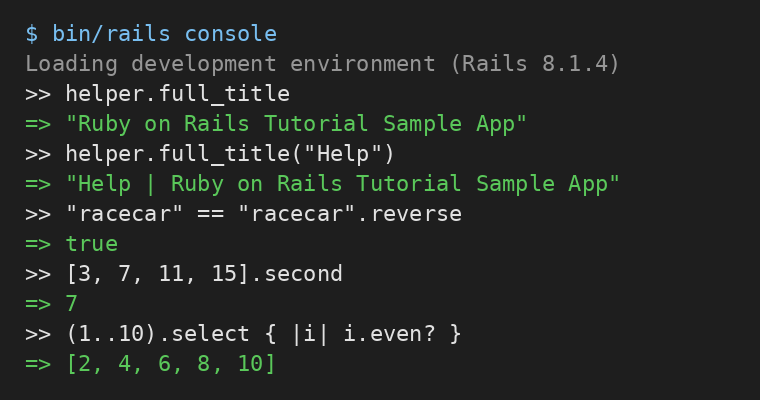

# Лабораторная работа №4. Rails-приправленный Ruby

Учебное приложение sample app по книге *Ruby on Rails Tutorial* (глава 4).
Проект продолжает лабораторную работу №3 (статические страницы).

Выполнил: Мифтахов Р. Н., группа 4411.

## Что сделано

- хелпер `full_title` в `app/helpers/application_helper.rb` — формирует заголовок страницы;
- макет `app/views/layouts/application.html.erb` использует `full_title(yield(:title))`;
- на странице Home убран `provide(:title, ...)`, тест ждёт базовый заголовок;
- класс `User` в `example_user.rb` (`attr_accessor`, `initialize`, `formatted_email`, `alphabetical_name`);
- упражнения главы 4 — по одному файлу в каталоге `exercises/`.

## Запуск

```sh
bundle install
bin/rails test          # тесты
bin/rails server        # http://localhost:3000
ruby exercises/exercise_5_palindrome_check.rb
bin/rails runner exercises/exercise_8_array_access.rb
```

Отчёт по работе: `Отчет_ЛР4_Мифтахов.docx`.

## Краткий отчёт

**Теория.** В Ruby всё является объектом. Строки в двойных кавычках поддерживают интерполяцию `#{...}`, методы возвращают значение последнего выражения. Коллекции (массивы, диапазоны, хэши) обрабатываются блоками: `each`, `map`, `select`. Хелпер в Rails — метод модуля из `app/helpers`, доступный во всех представлениях.

**Хелпер `full_title`.** Если страница не задаёт заголовок, возвращается базовый; иначе — «Страница | базовый заголовок».

```ruby
def full_title(page_title = '')
  base_title = "Ruby on Rails Tutorial Sample App"
  if page_title.empty?
    base_title
  else
    page_title + " | " + base_title
  end
end
```

Главная страница приложения:



**Тесты.** Проверяют код ответа и тег `title` каждой страницы:



**Упражнения.** Результаты запуска упражнений 3–8 из каталога `exercises/`:



**Запуск в консоли Rails.** Упражнения раздела 4.6 и примеры из методички выполнены в `bin/rails console`.

Упражнения 1 и 2 — `string_shuffle` и `String#shuffle`:



Упражнения 3 и 4 — вложенный хэш `params` и `merge`:



Класс `User` из `example_user.rb`:



Хелпер `full_title` и примеры из главы:



**Вывод.** Изучены основные конструкции Ruby, используемые в Rails; хелпер `full_title` убрал дублирование заголовков в шаблонах, все тесты проходят.
